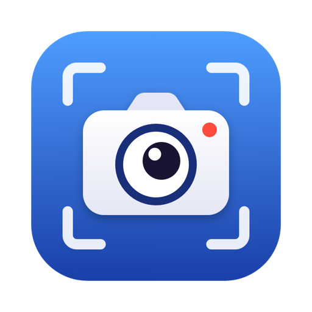
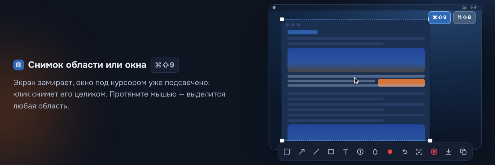
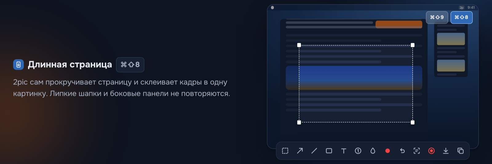
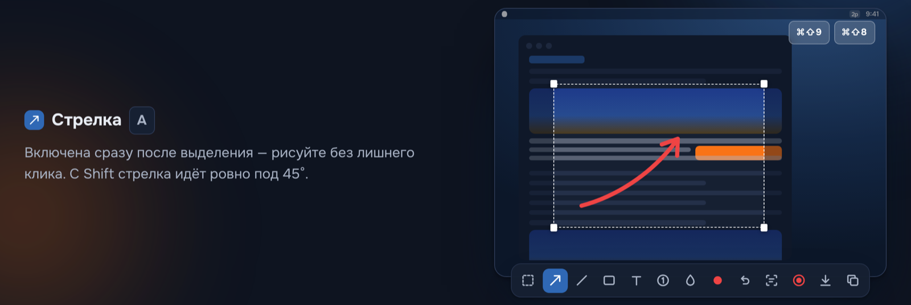
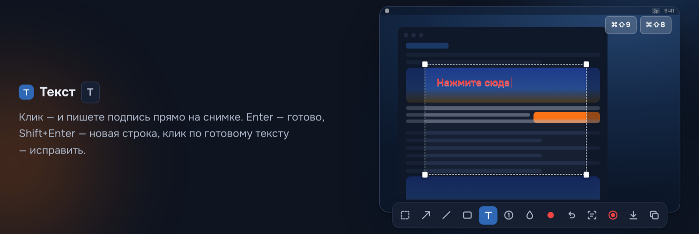
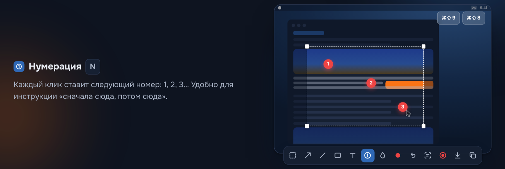
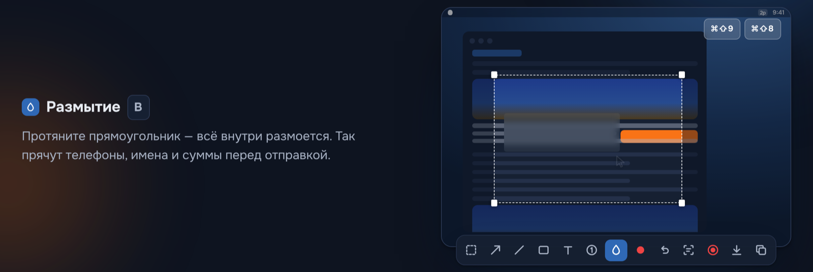
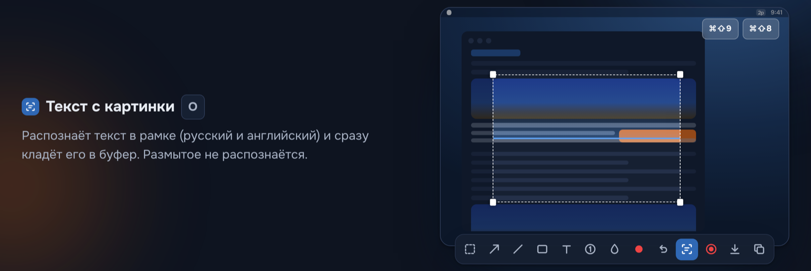
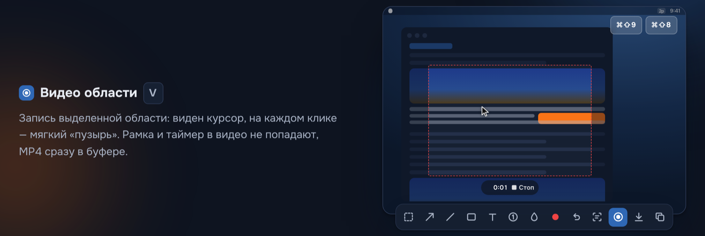

<p align="center"></p>

# 2pic

Скриншоты и видео на Mac в один клик. Живёт в строке меню, без значка в Dock, без аккаунтов и рекламы. Бесплатно, macOS 14 Sonoma и новее.

**Страница программы:** [eglibyte.ee/2pic.html](https://eglibyte.ee/2pic.html) · [на русском](https://eglibyte.ee/ru/2pic.html) · [in English](https://eglibyte.ee/en/2pic.html)



## Что умеет

- **⌘⇧9 — снимок области или окна.** Экран замирает, окно под курсором уже подсвечено: клик снимет его целиком, даже если поверх лежат другие окна. В браузере подсвечивается только страница, без вкладок и адресной строки. Протяните мышью — выделится любая область.
- **⌘⇧8 — длинная страница.** Выделите область или кликните по окну: 2pic сам прокрутит содержимое и склеит кадры в одну картинку. Липкие шапки и боковые панели не повторяются. Остановить раньше — любая клавиша или клик.
- **Пометки:** стрелка, линия, рамка, текст, нумерация, размытие; 8 цветов и 3 толщины.
- **Текст с картинки** (русский и английский) — сразу в буфер обмена.
- **Видео** выделенной области: курсор виден, на кликах — мягкий «пузырь». Файл MP4 сразу в буфере — ⌘V в мессенджере.
- **Свои горячие клавиши** — хоть ⌘⇧4 вместо встроенного снимка macOS.



## Установка

Одна команда в Терминале (Программы → Утилиты → Терминал):

```bash
curl -fsSL https://raw.githubusercontent.com/Egrom92/2pic/main/install.sh | bash
```

Если на Mac нет бесплатных инструментов разработчика Apple, откроется окно их установки: нажмите «Установить», подождите 5–15 минут и запустите команду ещё раз. Xcode не нужен. 2pic соберётся на вашем Mac, встанет в «Программы» и будет запускаться сам при входе в систему.

Один раз выдайте разрешения в «Системные настройки → Конфиденциальность и безопасность»:

1. **Запись экрана и системного звука** → 2pic, затем перезапустите 2pic (значок → «Выйти» и открыть снова).
2. **Универсальный доступ** → 2pic. Нужен для снимка с прокруткой и чтобы в браузере подсвечивалась только страница.

**Обновить** — та же команда, разрешения сохранятся. **Удалить:**

```bash
curl -fsSL https://raw.githubusercontent.com/Egrom92/2pic/main/uninstall.sh | bash
```

## Панель под выделением

После выделения сразу включена стрелка — можно рисовать. Края и углы выделения можно тянуть в любом режиме. Клавиши работают в любой раскладке, в том числе в русской.

| Кнопка | Клавиша | Что делает |
|---|---|---|
| ⌗ Выделение | C | потяните внутри рамки — она сдвинется; вне рамки — выделите заново |
| ↗ Стрелка | A | включена сразу |
| ╱ Линия | L | Shift — под 45° |
| ▭ Рамка | R | Shift — квадратная |
| Aa Текст | T | Enter — готово, Shift+Enter — новая строка; клик по тексту — исправить |
| ① Нумерация | N | каждый клик — следующий номер |
| 💧 Размытие | B | спрятать личное |
| ● Цвет и толщина | | выбор запоминается |
| ↶ / ↷ | ⌘Z / ⌘⇧Z | отменить / повторить |
| ⌸ Текст с картинки | O | распознаёт текст и копирует его |
| ⏺ Видео | V | запись выделенной области |
| ⤓ Сохранить | ⌘S | в папку из настроек (по умолчанию «Изображения/2pic») |
| ✕ Закрыть | Esc, правый клик | |
| ⧉ Скопировать | ⌘C, Enter, двойной клик | в буфер в полном Retina-разрешении |

| | |
|---|---|
|  |  |
|  |  |
|  |  |

## Видео

Выделите область и нажмите ⏺ или V. Красная рамка и таймер «● 0:12 ■ Стоп» в видео не попадают. Остановить — «■ Стоп», ещё раз горячая клавиша снимка или пункт «Остановить запись видео» в меню 2pic. Файл `2pic <дата>.mp4` сохраняется в папку из настроек и сразу лежит в буфере. Звук не записывается.

## Настройки

Значок 2pic → «Настройки…»:

- **Горячие клавиши.** Щёлкните по сочетанию и нажмите новое (Esc — отмена, ↺ — вернуть ⌘⇧9 / ⌘⇧8). Подойдёт любая клавиша с ⌘, ⌃ или ⌥, а F1–F15 — и без них. Если выбрать системное сочетание macOS (например, ⌘⇧4), 2pic предложит отключить системное; поставите другое или удалите 2pic — системное включится обратно.
- **Папка** для снимков и видео — по умолчанию своя, «Изображения/2pic». Её можно переименовать или выбрать другую (2pic предложит перенести туда свои файлы); стрелка рядом с именем открывает папку в Finder. Если папка пропала — например, отключён диск, — 2pic снова сохраняет в «Изображения/2pic».
- **В Корзину:** старые снимки и видео 2pic (файлы «2pic …») сами уходят в Корзину — по умолчанию через 7 дней, можно 1–30 дней или «Не убирать». Другие файлы в папке 2pic не трогает, а из Корзины всё можно вернуть.
- **Формат** снимков: PNG или JPEG. В буфер обмена снимок всегда копируется в PNG.
- **Сжимать до минимума** (включено): снимки и видео без Retina-удвоения, видео — HEVC, 30 кадров/с. Файлы в разы легче, текст читается.

## Ограничения

- Снимок с прокруткой — до 16 000 пикселей в длину (≈ 8 000 точек на Retina).
- Прокручивается только то, что попадает в выделенную область: чтобы попал низ страницы, выделяйте до нижнего края окна.
- Окно по клику снимается в момент клика, а не нажатия горячей клавиши; в скруглённых углах виден фон.

## Приватность

Снимки, распознанный текст и названия окон никуда не отправляются. Журнал (значок → «Диагностика») хранится только на этом Mac: в нём нет содержимого экрана и текста со снимков.

## Для разработчиков

- Swift Package (AppKit, ScreenCaptureKit), без зависимостей. `./install.sh` из папки проекта собирает и ставит текущую версию.
- Проверки: склейка прокрутки — `swift run -c release StitchCheck`; редактор без экрана — `swift build && .build/debug/TwoPic --selftest ui <папка>`.
- Отправка ошибок и статистики на свой сервер с уведомлениями в Telegram — см. [server/README.md](server/README.md). Поля для адреса и ключа появляются в «Настройках…», если открыть их с зажатым ⌥ Option.

## Другие программы

- [Oops](https://eglibyte.ee/ru/oops.html) — исправляет текст, набранный не в той раскладке
- [Peekaboo](https://eglibyte.ee/ru/peekaboo.html) — прячет лишние значки в строке меню
- [Magpie](https://eglibyte.ee/ru/magpie.html) — помнит всё, что вы копировали
- [Lark](https://eglibyte.ee/ru/lark.html) — звук, микрофон и пауза для всего, что играет

Все программы: [eglibyte.ee/ru/tools.html](https://eglibyte.ee/ru/tools.html)

## Лицензия

MIT — см. [LICENSE](LICENSE).
